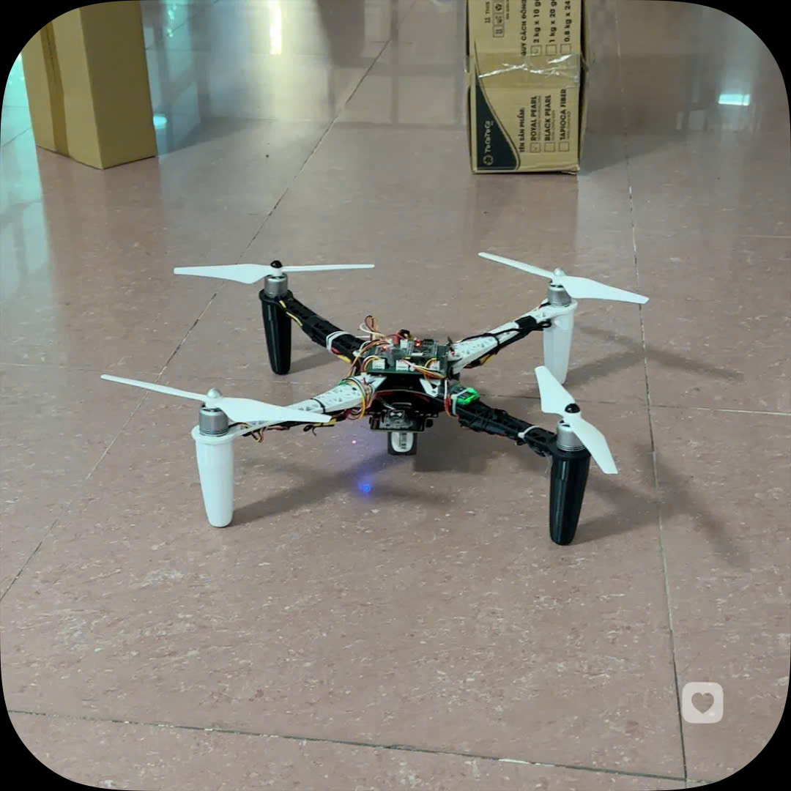
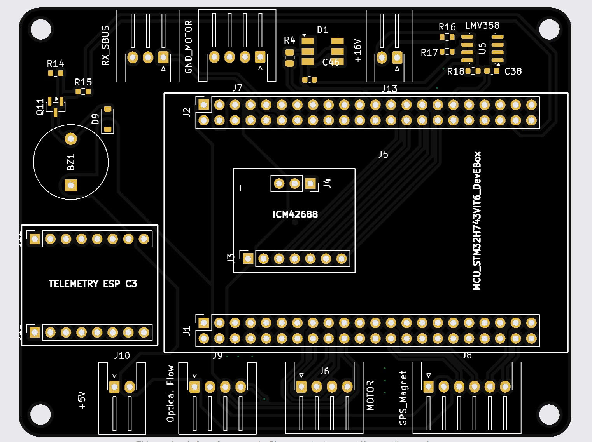
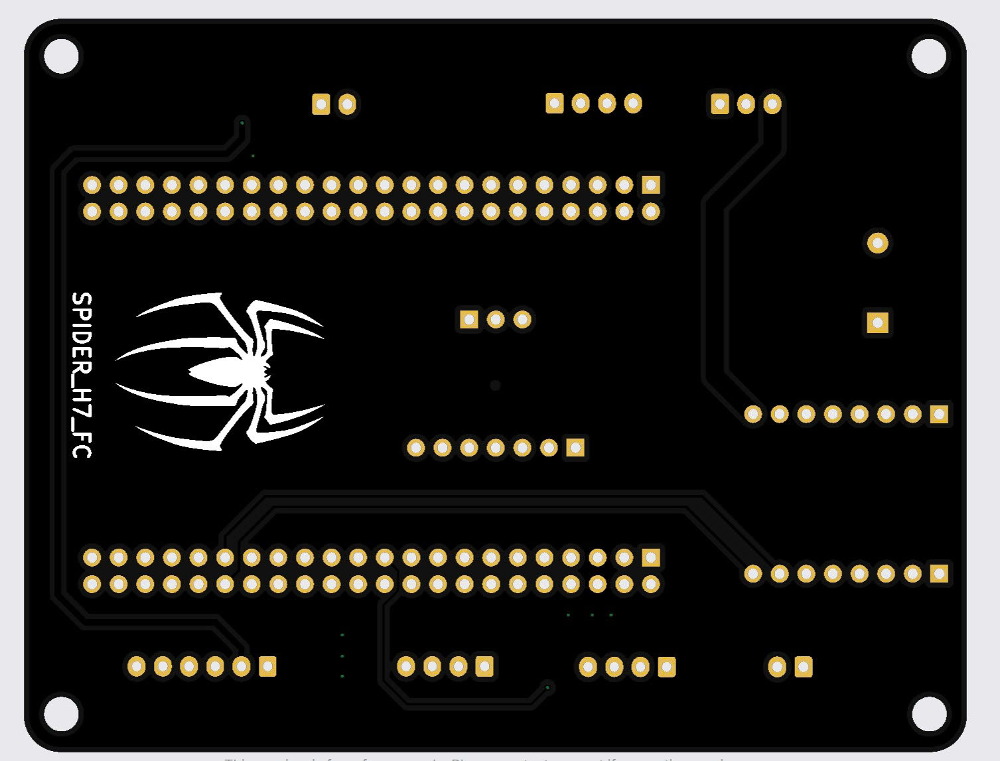
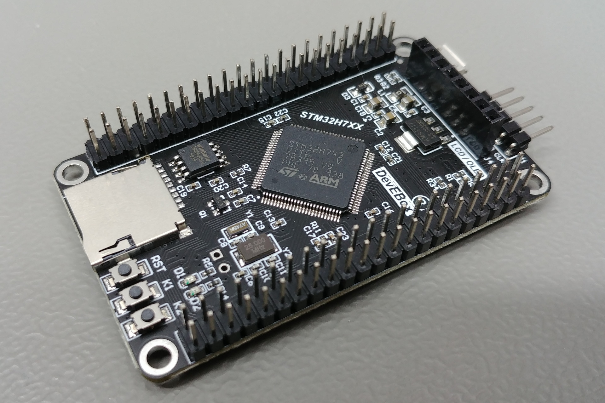
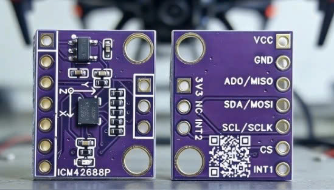
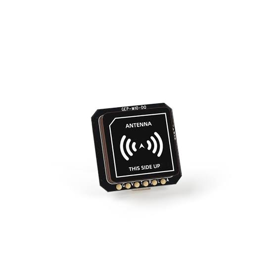
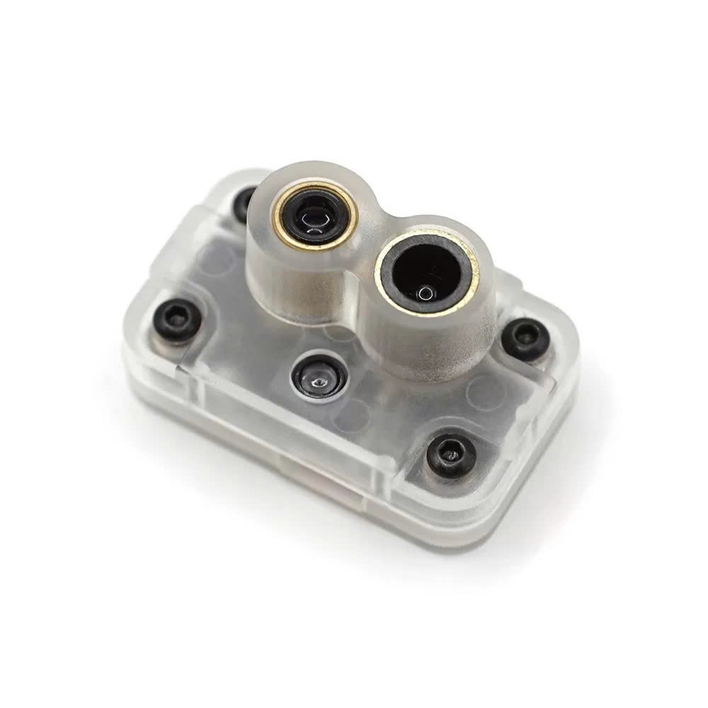

# 🕷️ SPIDER_H7_FC — STM32H743VIT6 Drone Flight Controller

> A custom-designed quadcopter flight controller based on the **STM32H743VIT6** microcontroller, developed at **UET (University of Engineering and Technology, VNU Hanoi)**.

---

## 📸 Photos

### Assembled Drone

<p align="center">
  
</p>

---

### Flight Controller PCB — SPIDER_H7_FC

| Top View | Bottom View |
|:---:|:---:|
|  |  |

---

### Hardware Components

| Component | Description | Photo |
|-----------|-------------|-------|
| **STM32H743VIT6** | Main MCU — ARM Cortex-M7, 480 MHz, on DevEBox board |  |
| **ICM-42688P** | 6-axis IMU (Accelerometer + Gyroscope) via SPI |  |
| **GPS M10** | GNSS Module (u-blox M10) for position hold & navigation |  |
| **MTF-01P** | Optical Flow + ToF distance sensor for indoor positioning |  |

---

## 🗂️ Repository Structure

```
drone/
├── drone_stm32h743vit6_DevEBox/     # STM32CubeIDE firmware project
│   ├── Core/
│   │   ├── Inc/                     # Header files (main.h, tim.h, gpio.h, ...)
│   │   └── Src/                     # Source files (main.c, tim.c, gpio.c, ...)
│   ├── Drivers/                     # STM32 HAL & CMSIS drivers
│   └── drone_stm32h743vit6_DevEBox.ioc  # STM32CubeMX config file
│
├── drone_stm32h743vit6_module/      # KiCad PCB design project (SPIDER_H7_FC)
│   ├── *.kicad_pcb                  # PCB layout
│   ├── *.kicad_sch                  # Schematic
│   └── *.kicad_pro                  # KiCad project file
│
├── photos/                          # Project photos
│   ├── drone.jpg                    # Full assembled drone
│   ├── top.jpg                      # PCB top view
│   ├── bottom.jpg                   # PCB bottom view (SPIDER_H7_FC logo)
│   ├── STM32H743VIT6.jpg            # MCU DevEBox board
│   ├── icm42688.jpg                 # IMU sensor module
│   ├── gps_m10.jpg                  # GPS module
│   └── mtf01p.jpg                   # Optical flow sensor
│
├── spider_logo_svg/                 # Logo assets
│   └── spider_logo.svg
│
└── README.md
```

---

## ⚙️ Hardware Specifications

| Item | Detail |
|------|--------|
| **MCU** | STM32H743VIT6 — ARM Cortex-M7 @ 480 MHz, 2 MB Flash, 1 MB RAM |
| **IMU** | ICM-42688P — 6-axis, SPI interface |
| **GPS** | u-blox M10 (GEP-M10-D0) — Multi-constellation GNSS |
| **Optical Flow** | MTF-01P — Optical flow + Time-of-Flight distance |
| **Telemetry** | ESP32-C3 — Wi-Fi telemetry module |
| **RC Receiver** | SBUS protocol |
| **Motor Output** | 4× PWM via TIM3 (up to 16V motor power rail) |
| **Power** | +5V regulated supply, +16V motor power |
| **Extras** | Buzzer (BZ1), LMV358 op-amp, Magnetometer connector |

### PCB — SPIDER_H7_FC Connectors

| Connector | Function |
|-----------|----------|
| `J1 / J2` | MCU pin headers (STM32H743VIT6_DevEBox) |
| `J5` | DevEBox main header |
| `J6` | Motor outputs (×4) |
| `J7` | GND Motor |
| `J8` | GPS + Magnetometer |
| `J9` | Optical Flow |
| `J10` | +5V power input |
| `J13` | +16V motor power |
| `RX_SBUS` | SBUS receiver input |
| `TELEMETRY ESP C3` | Wi-Fi telemetry (ESP32-C3) |

---

## 🛠️ Development Tools

| Tool | Purpose |
|------|---------|
| **STM32CubeIDE** | Firmware development & flashing |
| **STM32CubeMX** | Peripheral & clock configuration (`.ioc`) |
| **KiCad** | PCB schematic & layout design |
| **STM32 HAL** | Hardware Abstraction Layer for peripherals |

---

## 🚀 Getting Started

### Firmware (STM32CubeIDE)

1. Clone this repository:
   ```bash
   git clone https://github.com/<your-username>/drone.git
   ```
2. Open **STM32CubeIDE** → `File > Open Projects from File System`
3. Select the `drone_stm32h743vit6_DevEBox/` folder
4. Build and flash to the DevEBox board via ST-Link

### PCB Design (KiCad)

1. Open **KiCad** → `File > Open Project`
2. Select `drone_stm32h743vit6_module/drone_stm32h743vit6_module.kicad_pro`
3. Open the schematic (`.kicad_sch`) or PCB layout (`.kicad_pcb`)

---

## 📋 Flight Controller Features

- ✅ **Custom PCB** designed with KiCad — compact form factor
- ✅ **High-performance MCU** — STM32H743 running at 480 MHz
- ✅ **6-axis IMU** — ICM-42688P for precise attitude estimation
- ✅ **GPS navigation** — u-blox M10 for position hold & waypoint flight
- ✅ **Optical Flow** — MTF-01P for indoor hovering without GPS
- ✅ **Wi-Fi Telemetry** — ESP32-C3 for real-time data monitoring
- ✅ **SBUS receiver** support for standard RC transmitters
- ✅ **4-motor PWM output** for quadcopter configuration

---

## 📄 License

This project is for educational purposes at **UET — VNU Hanoi**.  
Feel free to use and adapt with attribution.

---

<p align="center">
  
  <br/>
  <sub>SPIDER_H7_FC — Built at UET, VNU Hanoi</sub>
</p>
